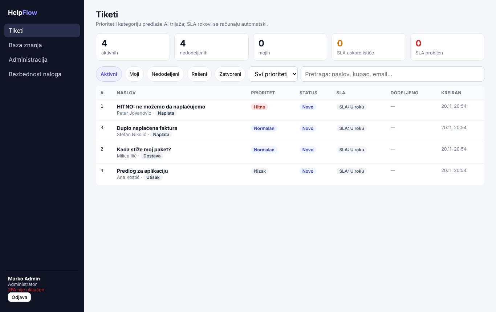
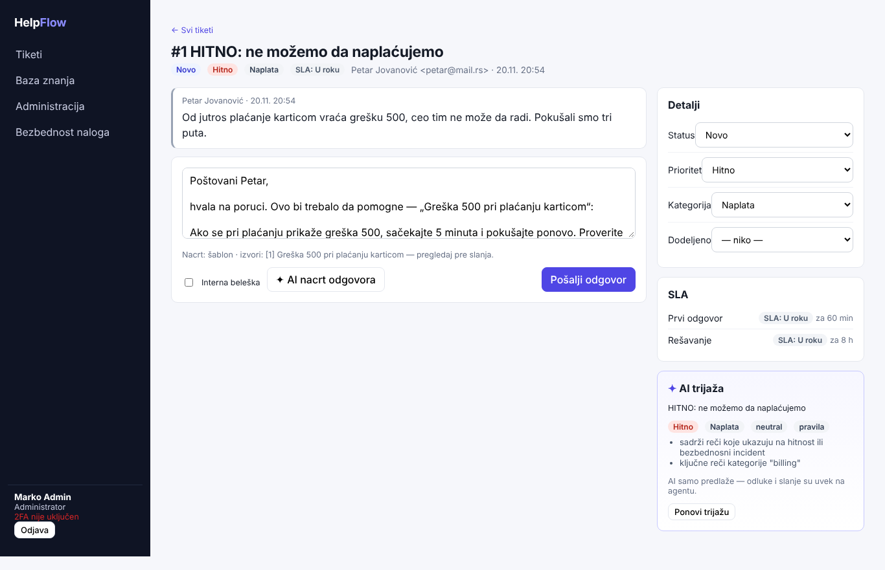
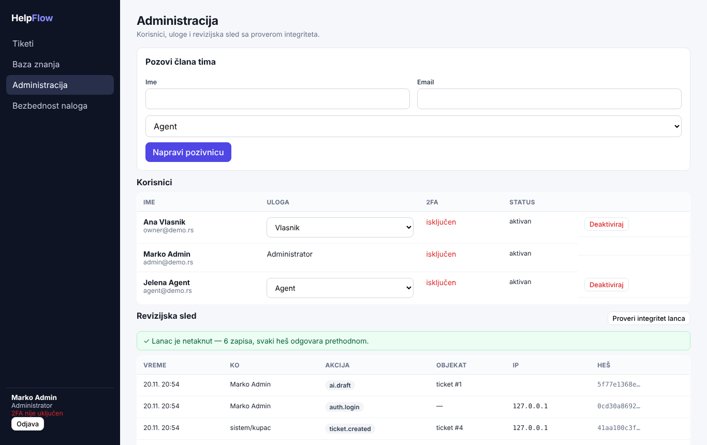
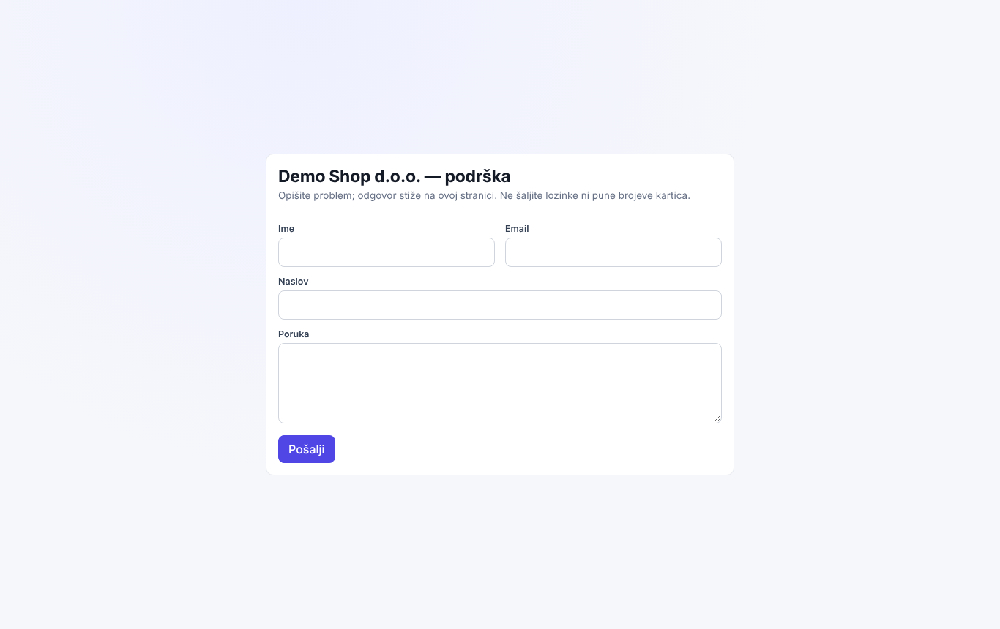

# HelpFlow

**Secure multi-tenant help desk with AI triage, SLA tracking and a tamper-evident audit trail.**


HelpFlow is a customer-support platform for companies that handle support requests by email or web form: a public customer portal, an agent inbox with SLA timers, a knowledge base, team administration and an AI assistant that suggests priority, category and a draft reply. The AI never acts on its own; a human agent always decides.

It is built the way a SaaS product handling other companies' customer data should be built: **tenant isolation enforced by the database itself**, phishing-resistant sessions, 2FA, a hash-chained audit log, and AI calls that never see personal data.

| Agent inbox | Ticket with AI draft |
|---|---|
|  |  |

| Administration and audit-chain verification | Customer portal |
|---|---|
|  |  |

## Features

- **Customer portal** (`/s/<company>`): customers open a ticket without an account and follow it through a private 256-bit link.
- **Agent inbox:** filters (mine, unassigned, solved), search, live counts, SLA "at risk" and "breached" indicators.
- **SLA engine:** first-response and resolution targets per priority (urgent 1 h / 8 h through low 24 h / 120 h). Status transitions are validated.
- **AI triage and drafts:**
  - Suggests priority, category and sentiment, with the reasons behind each suggestion.
  - Drafts replies grounded in the knowledge base (BM25 search) and cites its sources.
  - Supports Gemini or Claude, and falls back to a deterministic rule engine when no key is set or the model misbehaves.
- **Knowledge base** with role-based editing.
- **Team administration:** invites (single-use, expiring), roles (owner, admin, agent), deactivation, account unlock.
- **Account security page:** TOTP 2FA with recovery codes, active-session list with remote sign-out, password change.

## Security architecture

| Threat | Defense |
|---|---|
| Cross-tenant data access (IDOR, a forgotten `WHERE`) | PostgreSQL **Row Level Security** on every table (`FORCE ROW LEVEL SECURITY`). The app connects as a role without `BYPASSRLS`; the tenant is set per transaction with `SET LOCAL`. Other tenants' records return 404, so their existence never leaks. |
| SQL injection | Parameterized queries only; the DB role has no DDL rights. |
| Credential stuffing / brute force | Rate limits per IP **and** per account, plus progressive lockout (15 min, doubling, capped at 24 h). |
| Weak / breached passwords | Minimum 12 characters; optional Have I Been Pwned check using k-anonymity (only 5 hash characters leave the server). |
| Password database leak | Argon2id (OWASP parameters); session tokens and recovery codes are stored only as SHA-256 hashes. |
| Account enumeration / timing attacks | Identical responses for unknown users; dummy Argon2 verification; constant-time comparisons. |
| Session theft / XSS | `__Host-` cookie with `HttpOnly`, `Secure`, `SameSite=Strict`; idle (30 min) and absolute (12 h) timeouts; strict CSP without `unsafe-inline`; React output escaping. |
| CSRF | Session-bound HMAC token in a header, plus an `Origin` check. |
| Account takeover | TOTP 2FA (secret encrypted with AES-256-GCM), one-time recovery codes; password change revokes every other session. |
| Privilege escalation / mass assignment | Strict zod schemas (unknown fields rejected); role checks on the server; an admin cannot create owners, and the last owner cannot be demoted. |
| Log tampering / repudiation | Append-only `audit_log` (enforced by DB triggers) with a **per-tenant SHA-256 hash chain**, verifiable from the UI. |
| Prompt injection | Customer text is wrapped as untrusted data; model output is schema-validated. Draft links not found in KB sources are stripped, and replies are never sent automatically. |
| Personal data leaking to AI providers | Emails, phone numbers, IBANs, card numbers, JMBG, passwords and API keys are redacted before any LLM call. |
| Spam / abuse of public forms | Honeypot field, per-IP limits, 64 KB body limit. |
| Supply chain | `npm audit` in CI (fails on high severity), CodeQL `security-extended`, Dependabot. |
| Container breakout | Non-root user, read-only filesystem, `cap_drop: ALL`, `no-new-privileges`. |

Full threat model and OWASP ASVS mapping: [SECURITY.md](SECURITY.md).

## Tech stack

**Backend:** Node 22, TypeScript (strict), Express 5, PostgreSQL 17/18, zod, helmet, @node-rs/argon2, otplib
**Frontend:** React 19, React Router 7, Vite
**Tests:** Vitest + Supertest against a real PostgreSQL (embedded locally, a service container in CI), 48 tests covering tenant isolation, auth, CSRF, lockout, the audit chain, redaction, prompt-injection handling and SLA rules.

## Quick start (demo, no setup)

```bash
npm install
npm run demo
```

This starts an embedded PostgreSQL, applies migrations, seeds demo data and serves the app at http://localhost:3000.

| Role | Email | Password |
|---|---|---|
| Owner | owner@demo.rs | demo-lozinka-2026 |
| Admin | admin@demo.rs | demo-lozinka-2026 |
| Agent | agent@demo.rs | demo-lozinka-2026 |

Customer portal: http://localhost:3000/s/demo

## Production (Docker)

```bash
cp .env.example .env    # fill in ENCRYPTION_KEY, APP_ORIGIN, AI keys
export POSTGRES_PASSWORD=... APP_DB_PASSWORD=...
docker compose up -d --build
```

Put the app behind HTTPS (Caddy, Nginx or a PaaS). The server refuses to start in production with insecure cookies.

## Tests

```bash
npm test          # embedded PostgreSQL, no setup needed
npm run typecheck
```

## Project structure

```
db/migrations/      schema, RLS policies, app role, audit triggers
server/src/
  security/         sessions, CSRF, argon2, TOTP, AES-GCM, rate limits, audit chain, redaction
  ai/               triage, reply drafts, BM25 KB search, LLM providers
  domain/           SLA rules and status transitions
  routes/           auth, tickets, kb, admin, public portal
server/test/        security, domain and ticket API tests
client/src/         React SPA (inbox, ticket, KB, admin, settings, portal)
```

## License

MIT
